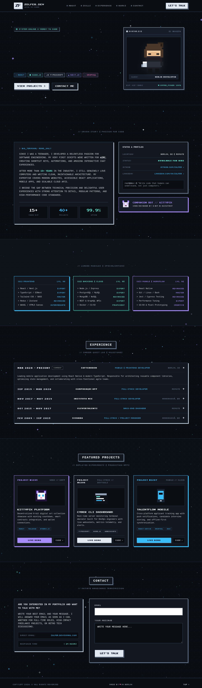

# Retro Pixel Developer Portfolio

Website portfolio bertema **Retro Pixel 8-Bit / Monospace** yang dibuat berdasarkan desain dari Google Stitch (`Responsive GitHub Portfolio Website`).

- **Screen 1 (Desktop)**: `Retro Pixel Portfolio - Animated Background` (ID: `98aff84ad88b4cb49eef15dd905dd05c`)
- **Screen 2 (Mobile)**: `Retro Pixel Portfolio - Mobile Responsive` (ID: `c8ded8e136894b6a95f6145338482795`)

| Tampilan Desktop (Screen 1) | Tampilan Mobile (Screen 2) |
|---|---|
|  |  |

---

## 🎨 Token Desain & Spesifikasi Persis (Stitch Design)

### 1. Hex Color Palette
| Token | Hex Code | Deskripsi |
|---|---|---|
| `retro.black` | `#0a0d12` | Background utama / dark canvas |
| `retro.dark` | `#121720` | Container & card background |
| `retro.card` | `#161d28` | Inner card background |
| `retro.accent` | `#E2E8F0` | Primary slate/silver accent |
| `retro.accentSubtle` | `#94A3B8` | Subtle slate text & border |
| `retro.sage` | `#5EEAD4` | Mint / sage green badge & highlight |
| `retro.lime` | `#4ADE80` | Retro lime green |
| `retro.cyan` | `#38BDF8` | Cyan terminal highlight & links |
| `retro.pink` | `#F472B6` | Pixel heart & accent |
| `retro.purple` | `#A78BFA` | Web3 card & companion bot highlight |
| `retro.muted` | `#64748B` | Secondary text & shadow accent |
| `retro.border` | `#273548` | Container divider & card borders |

### 2. Shadows & Borders
- **Border Radius**: `0px` (`rounded-none` di seluruh elemen untuk mempertahankan estetika 8-bit pixel art).
- **Pixel Shadows**:
  - `pixel-accent`: `4px 4px 0px #94A3B8`
  - `pixel-accent-sm`: `2px 2px 0px #64748B`
  - `pixel-purple`: `4px 4px 0px #A78BFA`
  - `pixel-cyan`: `4px 4px 0px #38BDF8`
  - `pixel-white`: `4px 4px 0px #CBD5E1`
  - `pixel-hover`: `5px 5px 0px #E2E8F0`

### 3. Tipografi
- **Pixel Heading**: `'Press Start 2P', monospace`
- **Pixel Subheading**: `'Silkscreen', monospace`
- **Body & Code**: `'Space Mono', 'JetBrains Mono', monospace`

---

## 🚀 Fitur Unggulan

- **Responsive**: Dioptimalkan penuh untuk Desktop, Tablet, dan Mobile (dilengkapi mobile navigation toggle).
- **Retro CRT Scanline & Dot Grid**: Background matrix radial gradient dan efek scanline CRT vintage.
- **Pure SVG Pixel Art**: Karakter avatar ninja, companion cat bot, dan icon project sepenuhnya berbasis SVG (tanpa dependensi gambar eksternal yang lambat).
- **Interactive**:
  - Accordion riwayat kerja (Experience Quest Log) dengan indikator rotasi `+` ke `x`.
  - Simulasi transmisi formulir kontak interaktif.
  - Smooth anchor scrolling ke seluruh section.
- **GitHub Pages Ready**: Tanpa proses build yang rumit. Langsung deploy via GitHub Pages atau GitHub Actions.

---

## 📦 Cara Deploy ke GitHub Pages

### Opsi 1: GitHub Actions (Otomatis & Direkomendasikan)
File workflow sudah tersedia di `.github/workflows/deploy.yml`.
1. Push repository ini ke GitHub:
   ```bash
   git init
   git add .
   git commit -m "feat: initial retro pixel portfolio"
   git branch -M main
   git remote add origin https://github.com/<username>/<repo-name>.git
   git push -u origin main
   ```
2. Di repository GitHub Anda, buka menu **Settings** > **Pages**.
3. Pada bagian **Build and deployment** > **Source**, pilih **GitHub Actions**.
4. Workflow akan otomatis berjalan dan website aktif dalam beberapa detik.

### Opsi 2: Deploy from a Branch (Manual)
1. Push file ke branch `main`.
2. Buka repository GitHub Anda > **Settings** > **Pages**.
3. Di bagian **Source**, pilih **Deploy from a branch**.
4. Pilih branch `main` dan folder `/ (root)`, lalu klik **Save**.

---

## 🛠️ Menjalankan Secara Lokal

Cukup buka [index.html](/home/silverking/Project-dev/portfolio-bagas/index.html) langsung di browser Anda, atau gunakan server lokal ringan:

```bash
# Python 3
python3 -m http.server 3000

# Atau Node.js
npx serve .
```

Buka `http://localhost:3000` pada peramban Anda.
